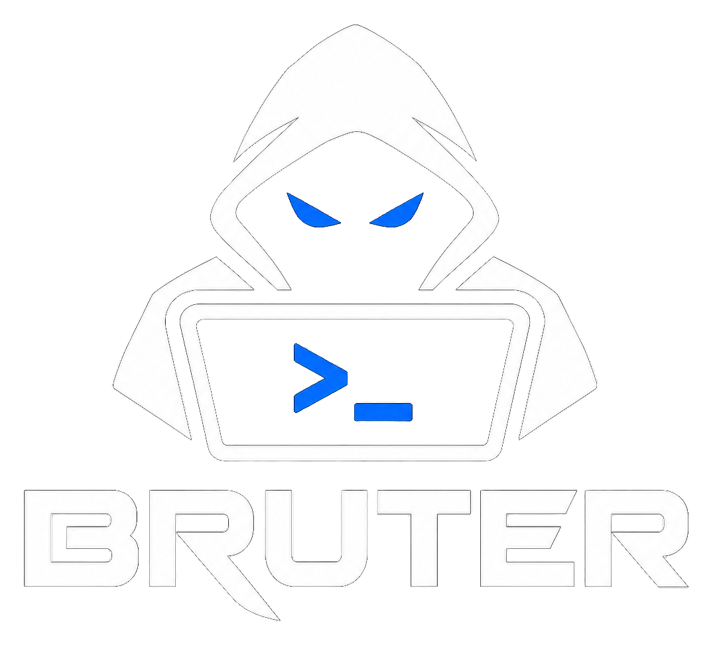

[](https://github.com/CyberRoute/bruter/actions/workflows/go.yml)
[](https://github.com/CyberRoute/bruter/actions/workflows/golangci-lint.yml)
[](https://goreportcard.com/report/github.com/CyberRoute/bruter)

<div align="center">
    
</div>
# Bruter
Bruter is a simple app that was built as an experiment while learning Go. It is indeed very much inspired by [Xray](https://github.com/evilsocket/xray) git  (but hey not copied ;)). The tooling can be used to test webservers and validate webservers configurations, but not just!

What does it do?
- It grabs HostInfo data from Shodan APIs, so you will need a Token to try this out
- It collects banners for various services FTP, SSH, MYSQL, IRC, SMTP
- It collects HTTP headers
- It brute force directories on WebServers and reports results (200)
- It provides info from crt.sh about SSL certificates
- DNS enumeration — A, AAAA, NS, TXT, CNAME, MX, SOA and reverse-DNS (PTR) records
- Zone-transfer (AXFR) check — attempts a full zone transfer against each authoritative name server and flags any that leak the zone
- Email-spoofing posture — parses SPF and DMARC and reports whether the domain is spoofable
- Subdomain discovery — passive sources (crt.sh and fallbacks) plus an active, wildcard-aware brute-force of common labels
- Reverse IP — other host names sharing the target's IP ("neighbours")
- Comprehensive IP info (Robtex) — owning network (ASN/route/whois) and active/passive DNS history
- **HTTP probing** — resolves and fetches discovered hosts, capturing status, title, server, technology hints, reflective CORS and missing security headers
- **Subdomain takeover detection** — flags dangling CNAMEs pointing at unclaimed hosting services (GitHub Pages, S3, Heroku, …) using a fingerprint database
- **XSS scanning** — runs the [dalfox](https://github.com/hahwul/dalfox) scanner (v3) against a supplied URL and reports reflected/DOM cross-site-scripting PoCs with confidence and scan metadata (requires the `dalfox` v3 binary on the server's `PATH` — `brew install dalfox`)
- **Crawl-driven automated XSS** — a same-host crawler plus static JavaScript analysis discovers the scan surface (parameterised URLs, form actions and JS endpoints), which feeds a background scan job that runs dalfox across every selected target with live progress and streaming findings
- It supports custom wordlists
- It produces a Web UI for presentation

> **Note on active checks.** Zone-transfer attempts, subdomain brute-force,
> HTTP probing and XSS scanning send live queries/requests/payloads to the
> target's infrastructure, and the reverse-IP and Robtex lookups query
> third-party services. Only run Bruter against systems you are authorised to
> test.

> **Network exposure.** The UI has **no authentication**, and the crawl/XSS/scan
> endpoints make live requests on the caller's behalf. Bruter therefore refuses
> to bind a non-loopback address unless you pass `-allow-remote`, rejects
> requests with a non-loopback `Host` header (DNS-rebinding protection), and
> requires `Content-Type: application/json` for API mutations. Treat
> `-allow-remote` as "anyone who can reach this port can run scans".

## Usage
```
   -address string
    	IP address to bind the web UI server to. (default "127.0.0.1")
  -allow-remote
    	Allow the UI to be reached from non-loopback addresses. The UI has no
    	authentication and its scan endpoints make live requests, so only use
    	this on a trusted network.
  -delay duration
    	Delay before each request, per worker (e.g. 100ms). Default 0 (no delay).
  -dictionary string
    	File to use for enumeration. (default "db/apache-list")
  -domain string
    	Domain to scan
  -extension string
    	File extension. (default "js")
  -max-rate int
    	Global cap on requests per second across all workers. Default 0 (unlimited).
  -shodan string
    	Dhodan API key
  -verbose
    	Verbosity
  -workers int
    	Default is 0, if workers is less than or equal than zero, it will be auto scaled to the number of logical CPUs usable by the current process.
```

`-domain` accepts a bare host, a `host:port` pair or a full URL
(`https://www.msd.com/path`). It is normalised to the bare hostname in lower
case, with a leading `www.` stripped: enumeration targets the registrable
domain, so `-domain https://www.msd.com` scans `msd.com`. Other subdomains are
left untouched (`https://sub.msd.com` stays `sub.msd.com`).

## Web UI
The presentation layer is a React single-page app (Vite + TypeScript + Tailwind)
that lives in [`web/`](web/) and is **embedded into the Go binary** via `go:embed`.
It presents the scan as tabs — **Dashboard** (host/network, ports, banners,
headers), **Subdomains** (passive + active brute-force, plus HTTP probing and
subdomain-takeover detection), **DNS** (records, zone
transfer, SPF/DMARC, reverse-IP and Robtex) and **XSS** (crawl + JS analysis →
automated dalfox scanning with live findings) — backed by a
small JSON API that the SPA consumes:

| Endpoint | Description |
| --- | --- |
| `GET /api/host` | Host/network info, open ports, MX records, grabbed banners, HTTP headers |
| `GET /api/ssl` | Certificate-transparency records (crt.sh and fallbacks) |
| `GET /api/dns` | DNS records (A, AAAA, NS, TXT, CNAME, MX, SOA, reverse-DNS PTR) plus a zone-transfer (AXFR) check against each name server and an SPF/DMARC email-spoofing verdict |
| `GET /api/subdomains/brute` | Active brute-force of common subdomain labels (wildcard-aware), returning resolved hosts and their IPs |
| `GET /api/reverseip` | Reverse-IP lookup — other host names sharing the domain's IP ("neighbours"), via an external source |
| `GET /api/robtex` | Robtex comprehensive IP view — owning network (ASN/route/whois) and active/passive DNS history, via an external source |
| `POST /api/probe` | HTTP probe + subdomain-takeover check for a posted list of hosts (`{"hosts":[...]}`) — status, title, server, tech, CORS, missing security headers, takeover flags |
| `POST /api/xss` | Active XSS scan of a single URL (`{"url":"https://host/path?q=1","cookie":"sid=…","skip_mining":false}`) via the dalfox v3 binary — returns `{target, count, pocs, meta}` where each PoC has param, payload, type, severity and confidence (`503` if dalfox is not installed, error if the target could not be scanned) |
| `POST /api/crawl` | Same-host crawl + JS analysis of a seed (`{"url":"https://host/","depth":2,"max_pages":100,"cookie":"…"}`) — returns `{seed, pages, targets:[{url, params, source, method, data, reflect_url}]}` (source = link/form/js; `method`/`data`/`reflect_url` are set on non-GET forms) |
| `POST /api/scan` | Start a background scan job over many targets (`{"targets":[…],"options":{…}}`; each target is a URL string or `{url, method, data, reflect_url}` so a POST form is scanned as a POST; options map to dalfox flags, numeric values clamped) — returns `{job_id}` (`503` if dalfox is not installed, `429` when the job limit is reached, `400` above 500 targets) |
| `GET /api/scan/{id}` | Poll a scan job — `{state, done, total, findings, targets, truncated, …}` (state = queued/running/done/stopped/error, per-target state also `stopped`; each target carries its dalfox `meta`). Finished jobs are retained for 30 minutes, then evicted |
| `POST /api/scan/{id}/stop` | Cancel a running scan job |
| `GET /consumer` | Live directory-fuzzing feed (polled by the dashboard) |

Because the UI is embedded, you must build `web/dist` before building the Go
binary. The `Makefile` and `Dockerfile` do this for you:

```
make ui        # build only the web UI (web/dist)
make           # build the UI, then test/lint/build the Go binary
```

Building by hand:
```
npm --prefix web ci
npm --prefix web run build
go build -o build/bruter ./cmd/bruter
```

### UI development
For hot-reload while developing the UI, run the Go server (which serves the API)
and the Vite dev server side by side — Vite proxies `/api` and `/consumer` to
`127.0.0.1:8080`:
```
go run cmd/bruter/* -domain example.com -shodan [TOKEN]   # API on :8080
npm --prefix web run dev                                  # UI on :5173
```

## Running in Docker
The Docker build compiles the UI in a Node stage and embeds it into the binary,
so no extra steps are needed:
```
docker build -t bruter .
# The container must listen on all interfaces for the published port to work;
# -allow-remote is required for that (see the network-exposure note above).
docker run --rm -it -p 8080:8080 bruter -domain example.com -shodan [shodanapikey] -verbose -address 0.0.0.0 -allow-remote
```


## Example
    go run cmd/bruter/* -domain example.com -shodan [SHODANTOKEN] -verbose
    12:41PM INF Scanning IP 93.184.216.34 OK
    12:41PM INF UI running on http://127.0.0.1:8080/
    12:41PM INF http://example.com/.htaccess.bak => 404 Not Found
    12:41PM INF http://example.com/httpd/logs/access_log => 404 Not Found
    12:41PM INF http://example.com/logs/error.log => 404 Not Found
    12:41PM INF http://example.com/cgi => 404 Not Found
    12:41PM INF http://example.com/apache/logs/access_log => 404 Not Found
    12:41PM INF http://example.com/apache/logs/access.log => 404 Not Found
    12:41PM INF http://example.com/logs/access.log => 404 Not Found
    12:41PM INF http://example.com/logs/error_log => 404 Not Found
    12:41PM INF http://example.com/httpd/logs/error.log => 404 Not Found
    12:41PM INF http://example.com/logs/access.log => 404 Not Found
    12:41PM INF http://example.com/cgi-bin => 404 Not Found
    12:41PM INF http://example.com/httpd/logs/error_log => 404 Not Found
    12:41PM INF http://example.com/.web => 404 Not Found
    12:41PM INF http://example.com/httpd/logs/access.log => 404 Not Found
    12:41PM INF http://example.com/.meta => 404 Not Found
    12:41PM INF http://example.com/apache/logs/error.log => 404 Not Found
    12:41PM INF http://example.com/apache/logs/error_log => 404 Not Found   

## Contribute
Fork the repo and send PRs

```
make all

Cleaning up
rm -rf build
Running tests...
go test ./... -v -cover -race
?   	github.com/CyberRoute/bruter/cmd/bruter	[no test files]
?   	github.com/CyberRoute/bruter/pkg/config	[no test files]
?   	github.com/CyberRoute/bruter/pkg/grabber	[no test files]
?   	github.com/CyberRoute/bruter/pkg/handlers	[no test files]
?   	github.com/CyberRoute/bruter/pkg/models	[no test files]
?   	github.com/CyberRoute/bruter/pkg/render	[no test files]
?   	github.com/CyberRoute/bruter/pkg/shodan	[no test files]
=== RUN   TestUrlJoin
--- PASS: TestUrlJoin (0.00s)
=== RUN   TestAuth
{"level":"info","time":"2023-03-10T14:25:36+01:00","message":"http://127.0.0.1:36983/ => 200 OK"}
{"level":"info","time":"2023-03-10T14:25:36+01:00","message":"http://127.0.0.1:44337/ => 403 Forbidden"}
{"level":"info","time":"2023-03-10T14:25:36+01:00","message":"http://127.0.0.1:45357/ => 500 Internal Server Error"}
--- PASS: TestAuth (0.01s)
PASS
	github.com/CyberRoute/bruter/pkg/fuzzer	coverage: 71.0% of statements
ok  	github.com/CyberRoute/bruter/pkg/fuzzer	0.044s	coverage: 71.0% of statements
=== RUN   TestResolveByName
=== RUN   TestResolveByName/valid_domain
=== RUN   TestResolveByName/invalid_domain
--- PASS: TestResolveByName (0.14s)
    --- PASS: TestResolveByName/valid_domain (0.00s)
    --- PASS: TestResolveByName/invalid_domain (0.13s)
PASS
	github.com/CyberRoute/bruter/pkg/network	coverage: 26.7% of statements
ok  	github.com/CyberRoute/bruter/pkg/network	0.165s	coverage: 26.7% of statements
Running lint...
golangci-lint run  # bootstraps the pinned v2.15.0 into ./bin if not on PATH
Formatting...
gofmt -s -w .
Building...
go build -o build/bruter cmd/bruter/*.go

```


## License
Bruter is developed by Alessandro Bresciani with some help from various projects and released with GPL license.

## Acknowledgments
[DB file](https://github.com/CyberRoute/bruter/blob/main/db/dict.txt) has been borrowed from [dirsearch](https://github.com/maurosoria/dirsearch/blob/master/db/dicc.txt)